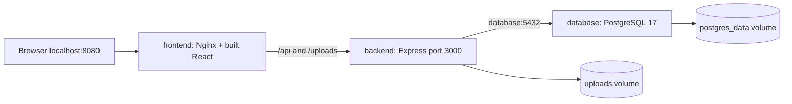

# Architecture and Docker concepts

An **image** is the packaged application and its dependencies. A **container** is a running instance of that image. A **Dockerfile** explains how to create an image. **Compose** builds, networks and starts all three services together.

- `frontend`: Vite builds React and Tailwind in a Node build stage. The final image uses unprivileged Nginx on port 8080. It serves the SPA and forwards API/photo requests to `backend:3000`. Browser code uses relative `/api` URLs, so container service names never need to resolve in the browser. Direct page refreshes work through the Nginx SPA fallback.
- `backend`: Express runs as the unprivileged `node` user. It uses `database`, the Compose DNS name, rather than `localhost` to reach PostgreSQL. `localhost` inside a container means that container itself. Dependencies install reproducibly using committed lockfiles and `npm ci`.
- `database`: PostgreSQL stores relational records. `database/init.sql` creates tables, constraints, indexes, the timestamp trigger and categories on the **first initialization of an empty volume**.
- `hostelswap`: a dedicated bridge network lets the containers find each other by service name. Only the frontend is exposed to the host, bound to loopback; database and backend ports are not published.
- `postgres_data`: named persistent storage for PostgreSQL. Removing a container does not remove this data.
- `uploads`: a separate named volume for photos. The Node user's upload directory initializes its ownership on first volume creation. Uploaded names are random UUIDs, never client-provided filenames.
- Health checks ensure PostgreSQL and Express are ready before their dependents start. Express also retries its initial database connection for up to 60 seconds. `pg.Pool` creates new connections after a database restart.

See [Docker’s health-check dependency documentation](https://docs.docker.com/compose/how-tos/startup-order/) and [Express’s Multer documentation](https://expressjs.com/en/resources/middleware/multer/) for the underlying mechanisms.

## Schema and data lifecycle

`users → listings ← categories` and `users → reports ← listings` form the core relationships. Email and category names are unique. A student can report a listing once. Prices must be positive; conditions, statuses and roles are constrained. Database indexes support status/date, category/price, condition, location, seller and report-status filtering. Case-insensitive keyword search uses parameterized `ILIKE`; add PostgreSQL trigram indexes if the dataset grows substantially.

Deleting a listing cascades its reports; deleting a user cascades their listings and reports. Categories with listings cannot be deleted. A trigger updates `listings.updated_at`. `pre_hidden_status` preserves available/sold state during moderation.

`init.sql` is a first-run initializer, not a versioned migration framework. For a schema change on an existing volume, create and apply a reviewed SQL migration with `psql`; editing `init.sql` alone will not update that volume. Back up before destructive schema changes. Do not reset a real dataset just to apply a schema change.

